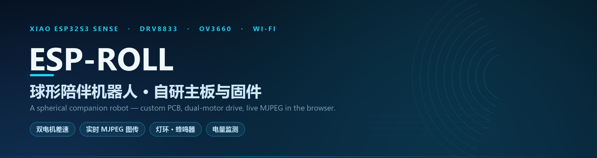
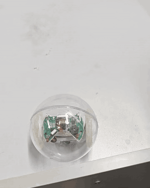
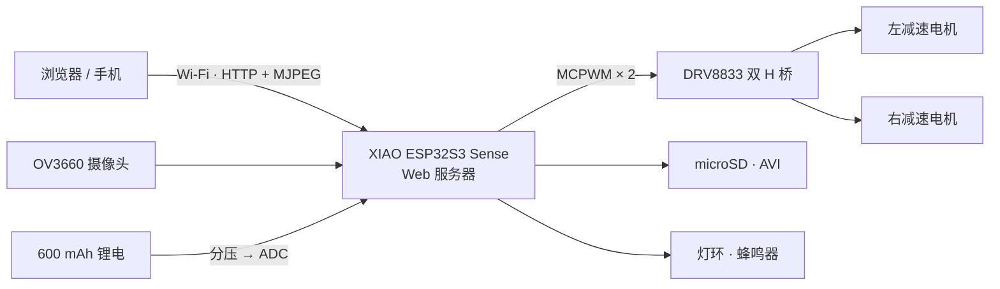
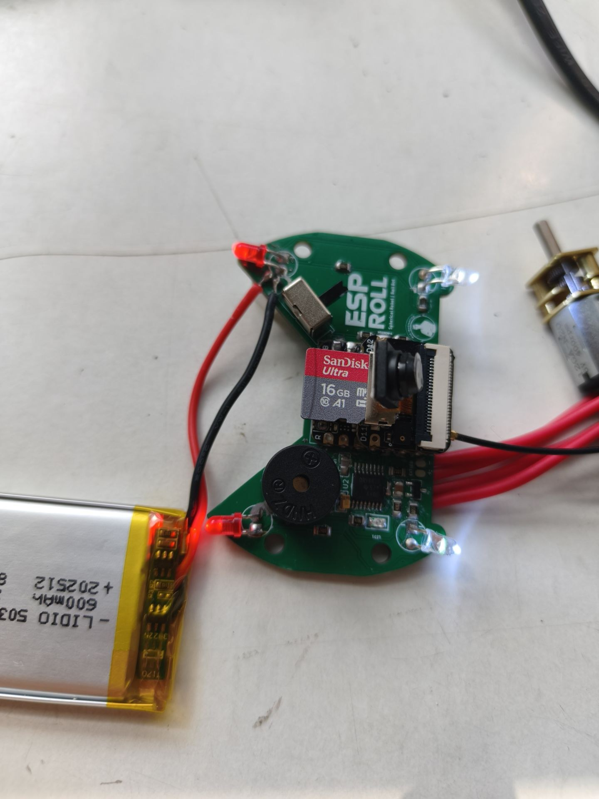
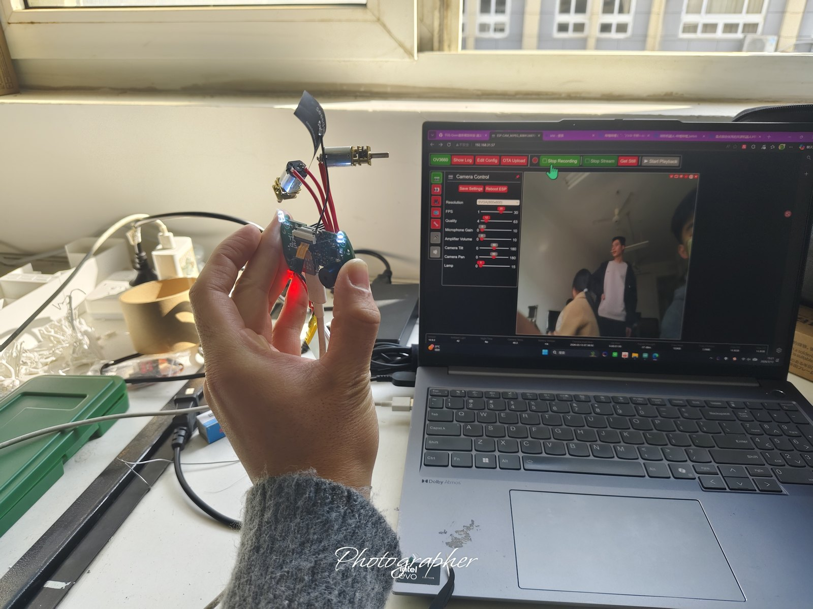
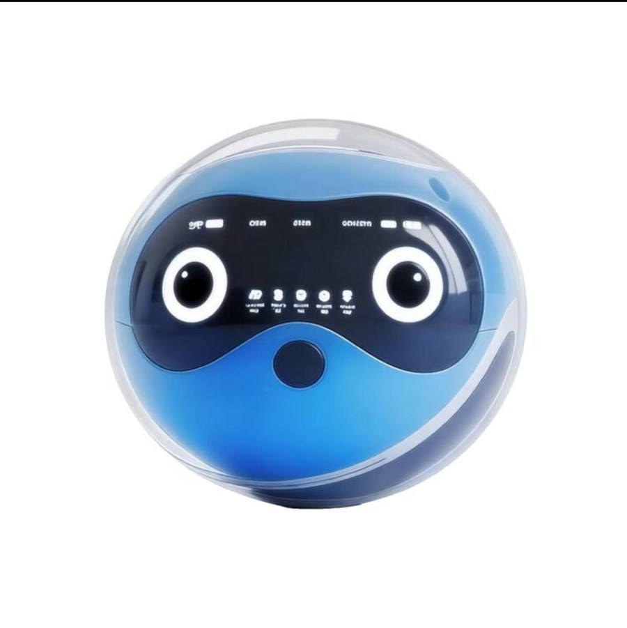
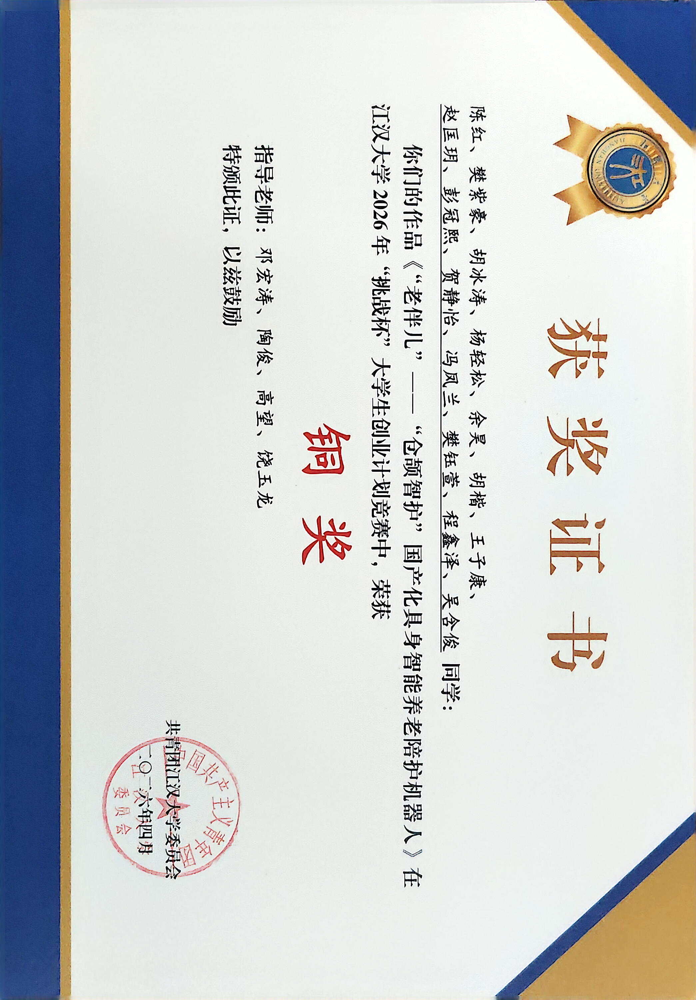

<div align="center">



# ESP-ROLL · 球形陪伴机器人
### ESP-ROLL Spherical Companion Robot — XIAO ESP32S3 Sense × DRV8833 × MJPEG

**把摄像头、双电机、灯环和整套网页控制，塞进一颗会滚的球里**

[](https://github.com/leisure-Y101/esp32roll/stargazers)
[](https://github.com/leisure-Y101/esp32roll/network/members)
[](https://github.com/leisure-Y101/esp32roll/commits/main)


**中文** · [English](#-english)

</div>

<div align="center">



**[▶ 看 6 秒完整原片（带声音）](media/demo.mp4)**

</div>

---

> **一颗球，一块板，一个网页链接。**
>
> 打开浏览器就是第一视角，推滑杆它就走，按一下灯环就亮——不装 App，不配遥控器。

---

## ✨ 特性一览

| | 特性 | 说明 |
|---|---|---|
| 🤖 | **球形本体** | 透明球壳 + 内置双轮差速底盘，重心压在下半球，靠左右轮速差转向 |
| 📷 | **第一视角图传** | OV3660 采集 JPEG，经 Wi-Fi 直推 MJPEG，浏览器里就是实时画面 |
| 🕹️ | **网页即遥控器** | 固件内置 Web 服务器，滑杆控速、按键转向，零客户端 |
| ⚙️ | **双电机 H 桥** | DRV8833 驱动两路直流减速电机，MCPWM 输出可调占空比 |
| 🛑 | **松手即停** | 控制端失去活动后自动收油，球不会带着上一帧指令一路冲出去 |
| 💾 | **板载录制** | AVI 写入 microSD，网页内可直接回放与下载 |
| 🔋 | **电量监测** | 600 mAh 单节锂电，分压进 ADC 实时读电压 |
| 💡 | **灯环 + 蜂鸣** | 独立灯环板做状态指示，蜂鸣器给操作反馈 |
| 🧩 | **单板集成** | 摄像头、SD、双电机、灯、蜂鸣、电池检测全部落在同一块主板上 |
| 📐 | **设计资料齐全** | 原理图、Gerber、BOM、贴片坐标、XIAO 封装源文件全部归档 |

---

## 🏗️ 系统架构



- **控制侧**：浏览器发 HTTP 指令 → 固件落到 MCPWM 占空比 → 两轮转速差 → 球体前进或转向。
- **画面侧**：摄像头出 JPEG，Web 服务器按 multipart 连续下发，浏览器用一个 `` 就能收流。
- **电源侧**：单节锂电同时喂电机与 ESP32S3，电机启动瞬间的压降是这块板最需要照顾的地方。

---

## 📸 实物

<div align="center">

| 主板实物 | 浏览器端实时图传 | 产品形态 |
|:---:|:---:|:---:|
|  |  |  |
| **ESP ROLL 丝印 · 16 GB microSD · 摄像头座 · 蜂鸣器 · 四角灯** | **左侧手持主板，右侧笔记本上就是它传回的画面** | **装进球壳后的样子（渲染）** |

</div>

---

## 📦 目录结构

```text
esp32roll/
├── firmware/
│   └── ESP32-CAM_MJPEG2SD/    Arduino 固件（ESP-ROLL 适配版）
│       ├── appGlobals.h       板型与功能开关
│       ├── camera_pins.h      XIAO ESP32S3 Sense 引脚表
│       ├── mcpwm.cpp          双电机 MCPWM 驱动
│       ├── peripherals.cpp    灯、蜂鸣器、PIR 等外设
│       ├── webServer.cpp      HTTP 服务与网页下发
│       └── data/              板载网页（HTML / JS）
├── hardware/
│   ├── schematic/             主板原理图 + XIAO 模块原理图 PDF
│   ├── pcb/                   主板与灯环板 Gerber、BOM、贴片坐标、XIAO KiCad 源
│   └── datasheet/             ESP32-S3 数据手册、XIAO 引脚表
├── docs/                      中文技术文档与分析报告
├── photos/                    实拍图
└── media/                     README 用的横幅、动图、原片
```

---

## 🧰 硬件清单

| 模块 | 型号 | 说明 |
|---|---|---|
| 主控 | **Seeed XIAO ESP32S3 Sense** | 双核 240 MHz · 8 MB PSRAM · 板载 OV3660 与 PDM 麦克风 |
| 电机驱动 | **DRV8833** | 双 H 桥，两路独立 PWM |
| 执行器 | **2× 直流减速电机** | 差速驱动球体 |
| 电源 | **600 mAh 单节锂电** | 分压进 ADC 做电量监测 |
| 存储 | **microSD（FAT32）** | AVI 录像与网页回放，1-bit 模式 |
| 人机交互 | **灯环板 + 蜂鸣器** | 状态指示与提示音 |
| 结构 | **透明球壳** | 上下半球合模，轮组固定在下半球 |

### 主板引脚分配

| 功能 | GPIO |
|---|---|
| 左 / 右电机 | `1` `2` / `3` `4` |
| 电池检测 | `5`（ADC 分压） |
| 蜂鸣器 | `6` |
| microSD（CLK / CMD / D0） | `7` / `9` / `8` |
| 摄像头 XCLK / SIOD / SIOC | `10` / `40` / `39` |
| 摄像头数据 | `11`–`18` / `38` / `47` / `48` |
| 板载 PDM 麦克风 | `41` / `42` |
| 灯环控制 | `43` |

> 引脚定义见 [`camera_pins.h`](firmware/ESP32-CAM_MJPEG2SD/camera_pins.h) 与主板原理图；电机、灯、蜂鸣的通道号可在网页配置里改写。

---

## 🛠️ 软件栈

| 环节 | 技术 |
|---|---|
| 固件框架 | **ESP32-CAM_MJPEG2SD 10.6.1**（AGPL-3.0，s60sc） |
| 编译 | Arduino IDE + `arduino-esp32`，目标 ESP32S3 |
| 摄像头 | OV3660 · `esp32-camera` |
| 电机 | ESP-IDF **MCPWM**（参考 `bdc_motor` 组件的 H 桥思路） |
| 图传 | HTTP **multipart MJPEG** |
| 前端 | 板载 HTML / JS，随固件写入文件系统 |
| 存储 | `SD_MMC` 1-bit · AVI（MJPEG 帧序列） |

---

## 🚀 快速开始

### 1) 硬件

球壳内装入主板、电池与两枚减速电机，确认 **3V3–GND 不通**再上电（万用表蜂鸣档）。

### 2) 编译与烧录

用 Arduino IDE 打开 `firmware/ESP32-CAM_MJPEG2SD/ESP32-CAM_MJPEG2SD.ino`：

| 选项 | 值 |
|---|---|
| Board | **XIAO_ESP32S3** |
| PSRAM | **Enabled（OPI PSRAM）** |
| Partition Scheme | 带 SPIFFS/LittleFS 的 8 MB 方案 |
| Upload Speed | 921600 |

`appGlobals.h` 关键开关（已按本板配置好）：

```cpp
#define CAMERA_MODEL_XIAO_ESP32S3   // 板型
#define INCLUDE_MCPWM   true        // 双电机驱动
#define INCLUDE_PERIPH  true        // 灯、蜂鸣器等外设
#define INCLUDE_AUDIO   false       // 板载 PDM 麦克风，需要时改 true
```

### 3) 连网并打开控制台

串口日志会打印分配的 IP，浏览器直接访问该地址即可。首次使用在网页里把 SSID / 密码写进配置，重启后自动连接。

### 4) 开起来

滑杆给速度，按键转向；松手后 `autoControl` 生效，电机自动收油。

---

## 🧠 关键技术

1. **MJPEG 而不是 H.264**
   每一帧都是独立 JPEG，浏览器用原生 `` 收 multipart 流就能显示，不需要解码库、不需要 WebRTC 信令。代价是带宽，但对局域网点对点足够。

2. **MCPWM 驱动 H 桥**
   两路互补 PWM 分别控制 DRV8833 的两组输入，占空比映射转速、正负映射方向；`motorFwdPin / motorRevPin` 为空时自动退化为单向驱动，换驱动板不用改代码。

3. **失活即停（dead-man switch）**
   网页端 `autoControl` 打开时，超过设定时间没有新的控制指令就自动把电机拉回零。球体一旦跑出 Wi-Fi 覆盖，不会带着最后一条指令继续冲。

4. **SD 走 1-bit 模式**
   XIAO ESP32S3 Sense 的 SD 引脚与摄像头排线共用紧张资源，`SD_MMC` 只接 CLK / CMD / D0 三根线，`use1bitMode = true`。接成 4-bit 会直接挂载失败。

5. **单板电源是主要矛盾**
   电机启动瞬间的电流尖峰会把 3.3 V 拉塌，摄像头随即初始化失败或重启。板上的电池分压检测让电压跌落可观测，是排查这类问题的第一手数据。

6. **配置落盘，重新上电即恢复**
   SSID、电机通道、灯与蜂鸣的开关都写进 `configs.txt`（NVS），掉电重连后不用重新点一遍。

---

## 👀 操作方式

| 场景 | 操作 |
|---|---|
| 看画面 | 打开设备 IP，点「Start Stream」 |
| 前进 / 后退 | 速度滑杆，正负对应两向 |
| 转向 | 左右差速，一侧加速另一侧减速 |
| 录像 | 「Record」写 AVI 到 microSD，可在网页回放 |
| 灯光 / 提示音 | 网页开关直接驱动灯环与蜂鸣器 |

---

## 📚 文档

| 文档 | 内容 |
|---|---|
| [项目说明](docs/ESP-ROLL-项目说明.md) | 模块划分、SD 卡初始化与引脚排错 |
| [麦克风功能分析](docs/ESP-ROLL-麦克风功能分析.md) | 板载 PDM 麦克风启用路径 |
| [E18-D80NK 与语音方案](docs/ESP-ROLL-E18-D80NK-与语音方案分析.md) | 避障传感器与语音链路的可行性 |
| [难度评估报告](docs/ESP-ROLL-难度评估报告.md) | 分模块难度、引脚预算与实施路线 |

---

## 🏆 荣誉

<div align="center">



</div>

团队作品《「老伴儿」——「仓颉智护」国产化具身智能养老陪护机器人》获 **2026 年「挑战杯」大学生创业计划竞赛（江汉大学）铜奖**，本仓库的球形底盘与视觉/驱动方案为其移动平台的技术基础。

---

## ⭐ 支持

如果这个项目对你有启发，欢迎点个 **Star ⭐**。

也欢迎提 Issue 一起聊：球形底盘的重心、单板电源的纹波、ESP32S3 上同时跑图传与电机控制的取舍。

---

## 🌍 English

<div align="center"><b>ESP-ROLL — Spherical Companion Robot</b></div>

A palm-sized spherical robot built around a **Seeed XIAO ESP32S3 Sense** and a custom main board: dual DC gear motors on a **DRV8833**, an **OV3660** camera, a LED ring, a buzzer, and a 600 mAh LiPo — all inside a transparent shell, all driven from a web page.

- **Browser as the controller** — the firmware serves its own UI: live MJPEG, speed slider, steering, recording.
- **Differential drive** — two MCPWM channels into a dual H-bridge; steering is just a speed difference.
- **Dead-man switch** — control stops arriving, the motors stop. No runaway ball.
- **On-board recording** — AVI to microSD in 1-bit SD_MMC mode, playable straight from the web UI.
- **Full design archive** — schematic, Gerbers, BOM, pick-and-place and the XIAO KiCad source.

**Tech:** ESP32-S3 · OV3660 · DRV8833 · MCPWM · MJPEG · Arduino · ESP-IDF.

> If this project helps you, a ⭐ is appreciated.

---

## 📄 许可与致谢

| 组件 | 说明 |
|---|---|
| 固件底座 | [ESP32-CAM_MJPEG2SD](https://github.com/s60sc/ESP32-CAM_MJPEG2SD) by s60sc，**AGPL-3.0** |
| 主控模块 | Seeed Studio XIAO ESP32S3 Sense，遵循厂商许可 |
| 主板 / 灯环板设计 | 原理图、Gerber、BOM 随仓库提供，仅用于本项目的复现与改进 |

`firmware/` 目录继承了上游的 **AGPL-3.0** 许可，二次分发请保持开源并保留原版权声明。
